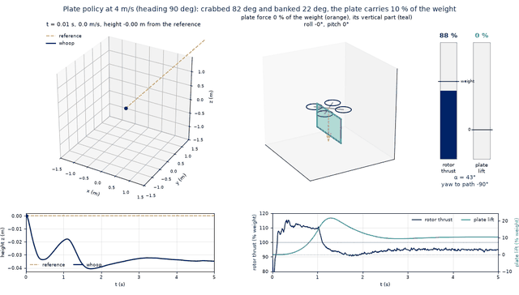
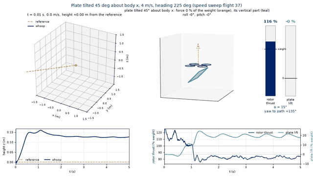
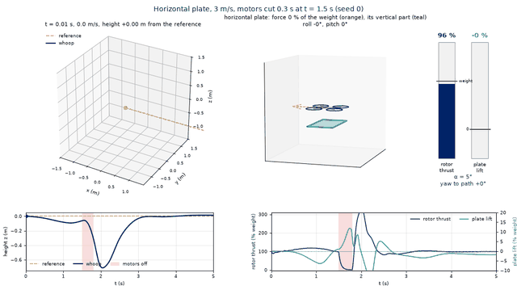
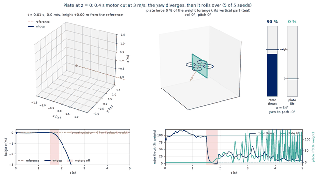
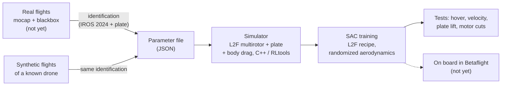
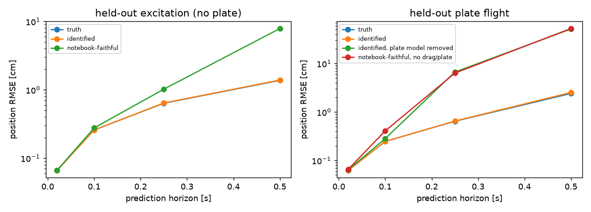
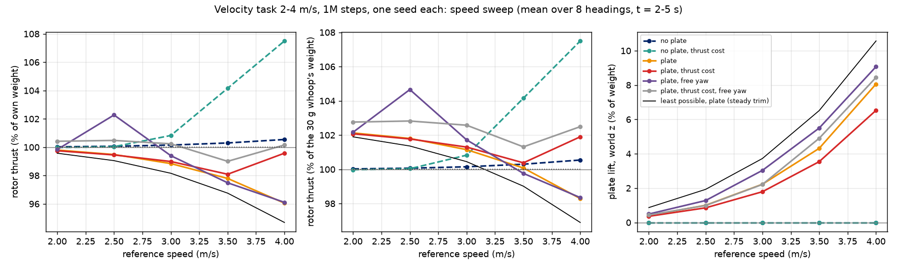

# whoop-airfoil

| The plate carries 10 % of the weight at 4 m/s | Plate tilted 45°: 20 % (no downwash in the model) |
| --- | --- |
|  |  |
| **Horizontal plate: back on the line after a 0.3 s motor cut** | **0.4 s motor cut: the whoop rolls over** |
|  |  |

*SAC policies flying the whoop with its plate, in simulation. In each: the path and the reference, a close-up of the
whoop with the plate force, rotor thrust and plate lift in % of the weight, and both against time. Details of each
flight in [`docs/sim.md`](docs/sim.md).*

A 30 g quadrotor ("whoop", 75 mm) with a 3 mm EPP foam plate under it, flown by a policy trained in simulation that
learns to use the plate's aerodynamic force. UC Berkeley MEng capstone, ARPL lab (Giuseppe Loianno, Jonas Eschmann).
Simulation only: the drone has not flown yet.

- The whole chain works sim-to-sim: a "true" drone is flown, identified from 2 min of flight, and a policy trained on
  the identified model flies the truth at 97 % success and 0.18 m RMSE.
- Hover and velocity tasks (1–4 m/s) with and without the plate: 87–99 % of test flights completed after 300k steps,
  about 1 min of training on a laptop core.
- The vertical plate saves at most 5 % of the rotor thrust at 4 m/s (it lifts 10 % of the weight), and the policy
  finds that bound. A tilted plate could save more, unless the rotors' downwash cancels it: that is the measurement
  the bench has to make.

## Pipeline

1. **Identification** ([`sysid/`](sysid/README.md)). The method of Eschmann, Albani, Loianno, "Data-driven system
   identification of quadrotors subject to motor delays" (IROS 2024): motor time constants, thrust curve, inertia,
   torque constant, plus the body drag and the plate's force coefficients. Validated on synthetic flights with
   blackbox and mocap noise.
2. **Parameters** ([`params/whoop_nominal.json`](params/whoop_nominal.json)), read by the simulator at run time.
   Assumptions until the drone is weighed and identified.
3. **Simulator** ([`sim/`](docs/sim.md)). The L2F multirotor environment of RLtools, not modified (commit b32d9985),
   with the plate's force and torque ([`docs/plate_model.md`](docs/plate_model.md)) and a linear body drag. 43 unit
   tests.
4. **Training.** SAC with the update intervals, batch and reward curriculum of "Learning to Fly in Seconds"; plate
   coefficients (±40 %) and body drag (±50 %) randomized.
5. **Tests.** 100 fixed flights per policy, a speed sweep (2–4 m/s, 8 headings) that measures rotor thrust and plate
   lift, and a motor-cut scenario.
6. **On board.** The actor is exported in L2F's checkpoint format for rl-tools/betaflight; not run on hardware yet.

## Results

### Identification

On 2 min of synthetic flight, the identification recovers the thrust curve, motor time constants, roll and pitch
inertia, torque constant and the plate's normal-force coefficients within about 1–2.5 % of the truth; the plate's
friction coefficient needs about 4 min. On held-out flights the identified model predicts the position as well as the
true one (1.4 cm after 0.5 s without the plate, 2.5 cm with it); without the plate model the error is about 50 cm
([`sysid/README.md`](sysid/README.md)).

### Training

One seed per variant, 300k steps on a laptop core, 100 test flights each, with the body drag and randomized
aerodynamics ([`docs/sim.md`](docs/sim.md)):

| Task | Without the plate | With the plate |
| --- | --- | --- |
| Hover from random starts | 99 %, 0.12 m, 46 s | 98 %, 0.35 m, 52 s |
| Fly at 1–4 m/s | 87 %, 0.40 m, 51 s | 92 %, 0.22 m, 57 s |

Success rate, position RMSE over the second half of the flights, training time. In the velocity task the plate force
averages 8 % of the weight, up to 64 %. At 1M steps the velocity task reaches 100 % without the plate and 97 % with it.

Sim-to-sim: a "true" drone that differs from the nominal one (thrust +10 %, motors 25 % slower, drag +30 %, C_N90
+20 %, K_px −15 %, [`params/whoop_truth_example.json`](params/whoop_truth_example.json)) is flown in synthetic
flights, identified (all within 1 % except d_z −2.7 % and C_T +10 %), and a policy trained on the identified file flies
the truth at 97 % success and 0.18 m RMSE, as on its own model. Policies trained on the nominal file also keep 97 % on
the truth (0.22–0.24 m): the randomization covers this truth. Two seeds each; one identified-file seed collapsed in its
last 100k steps (37 %).

### Does the plate carry weight?

A little, and only fast. In steady flight the rotor thrust and the plate's normal force are perpendicular, so the
vertical plate can at best carry 3.7 % of the weight at 3 m/s and 10.6 % at 4 m/s, for 1.8 % and 5.3 % less rotor
thrust, flying sideways with the plate face-on and banked 14–22° (`sim/tools/plate_trim.py`, black line). The trained
plate policy (2–4 m/s, 1M steps) reaches that bound in its best headings: 94.6 % of its weight in rotor thrust at
4 m/s with the plate lifting 10.2 %; over all 8 headings 96.1 %. A rotor power cost in the reward did not increase
the saving.

A plate tilted 30–60° carries weight at first order: at best 81.9 % of the weight in rotor thrust at 4 m/s with the
plate lifting 19.7 % (θ = 45°), and the 45° policy reaches it in the headings where the plate's lower face meets the
air (82.5 %). These numbers neglect the rotors' wake, which hits a tilted plate under the props; a crude downwash term
turns the 45° saving into a 9 % loss at 4 m/s ([`sim/figures/plate_tilt_trim.png`](sim/figures/plate_tilt_trim.png)).
The real effect is between, and was not measured.

### Motor cuts

Cutting all four motors at 3 m/s: without the plate the policy recovers from a 0.4 s cut, losing 1.1–1.6 m. With
the vertical plate it recovers from 0.2 s, but a longer cut rolls the whoop over: the plate, under the centre of mass,
makes the powerless fall unstable in roll. Moving the vertical plate up does not save a 0.3 s cut (1 flight of 15
came back); the horizontal plate is the only one back from 0.3 s (5 of 5), and every plate flips at 0.4 s. The plate never holds the whoop up ([`docs/sim.md`](docs/sim.md)).

## Not done

- 10-seed trainings on Savio (`sim/slurm/`): the results above are one or two seeds per variant.
- Real flights in the motion-capture room and identification of the real drone.
- The plate's effect on the rotors (downwash), to be measured on the bench.
- The policy on board (rl-tools/betaflight).

## Run it

Build and training commands, on Windows and on Savio: [`docs/sim.md`](docs/sim.md#build-test-run-windows-laptop).
Identification: [`sysid/README.md`](sysid/README.md#how-to-run). Animations: `python sim/tools/animate_flight.py
<run>/flights.csv <out.gif>`; the GIFs above are those of `docs/sim.md`, at 640 pixels and every second frame.

## Layout

| Folder | Content |
| --- | --- |
| `params/` | whoop and plate parameters, shared by the simulator and the identification |
| `docs/` | the plate model ([`plate_model.md`](docs/plate_model.md)), the simulator details ([`sim.md`](docs/sim.md)), the GIFs (`media/`) |
| `sim/` | C++ simulator, tests and training on top of RLtools (commit b32d9985, not modified) |
| `sysid/` | Python identification and its validation on synthetic flights |

## Credits

The simulator reuses the L2F environment of [RLtools](https://github.com/rl-tools/rl-tools) and the identification
follows the notebook of [data-driven-system-identification](https://github.com/arplaboratory/data-driven-system-identification).
