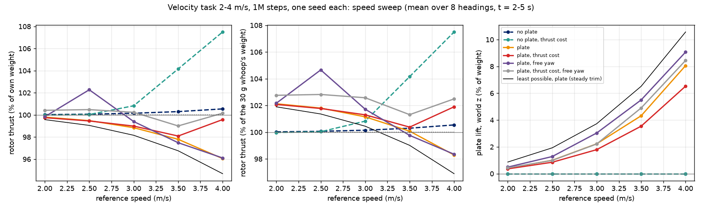

# Simulator and training (`sim/`)

The simulator is the L2F multirotor environment of RLtools ("Learning to Fly in Seconds", Eschmann, Albani, Loianno,
RA-L 2024) with the whoop parameters, plus the force and torque of the plate exactly as in `docs/plate_model.md`. The
policy is trained with the L2F training setup. Everything is C++ on top of RLtools (header-only, commit b32d9985), and
the RLtools checkout itself is not modified.

## Files

| file | what it does |
|---|---|
| `sim/tools/generate_params.py` | reads `params/whoop_nominal.json` and writes `whoop/params.h` into the build directory at build time. It checks the inputs and derives J⁻¹, the hover command and the mass and inertia with the plate |
| `sim/include/whoop/plate.h` | `plate_aerodynamics`: the equations of `docs/plate_model.md`, line by line |
| `sim/include/whoop/body_drag.h` | `body_drag_force`: the linear body drag of `docs/plate_model.md` |
| `sim/include/whoop/environment.h` | parameter, reward and task types, and `EnvironmentFactory<T, TI, PLATE, TASK>`: the L2F environment type with the whoop numbers, states and observations |
| `sim/include/whoop/operations.h` | the few L2F operations that change for the whoop (see "Design" below) |
| `sim/tests/test_whoop.cpp` | unit tests (`whoop_test`) |
| `sim/src/train.cpp` | training, evaluation and export (`whoop_train_*`), and the motor-cut scenario (`--scenario`) |
| `sim/include/whoop/params_runtime.h` | reads a parameter JSON at run time (`--params`, `--plate-z`) and derives J⁻¹, the hover command and the mass and inertia with the plate exactly as `generate_params.py` does |
| `sim/include/whoop/metrics.h` | what the evaluation measures: plate lift (world z of the plate force), plate force and total rotor thrust, over the weight |
| `sim/tools/animate_flight.py` | a `flights.csv` as a GIF: trajectory, close-up of the whoop and plate, gauges of rotor thrust, plate lift and angle of attack, height and forces against time |
| `sim/tools/plate_trim.py` | the least rotor thrust of steady straight flight that the plate model allows, per speed (a bound for the policies) |
| `sim/tools/plot_plate_lift.py` | rotor thrust and plate lift against speed from the speed sweeps of several runs |
| `sim/CMakeLists.txt` | the build: 1 test target and 8 training targets |
| `sim/slurm/setup.sh`, `build.slurm`, `train.slurm` | Savio: configure, build and test, then a 40-run array |

## Design: how the plate enters L2F without changing RLtools

L2F builds its parameters as a chain of structs (`ParametersBase` → `ParametersDisturbances` → ...). Its operations
(dynamics, initial state, reward) are template overloads on these types, and L2F calls them **unqualified**: the
integrator calls `multirotor_dynamics`, and the off-policy runner calls `sample_initial_parameters`,
`sample_initial_state`, `reward` and `log_reward`. `environment.h` adds one more link on top of the chain,
`whoop::ParametersWhoop`, which holds the plate and task parameters. `operations.h` then defines overloads in namespace
`whoop` that take `ParametersWhoop<...>&` where L2F takes any `PARAMETERS&`. Argument-dependent lookup finds them, and
C++ picks them because they are more specialized. Each overload calls back into L2F's own code for everything it does
not change:

- `multirotor_dynamics` (for `StateBase`) runs L2F's rigid-body and rotor equations with the L2F part of the
  parameters, then adds `R (F_plate + F_drag) / m` to dv/dt and `J⁻¹ τ_plate` to dω/dt (the plate when S > 0, the body
  drag when d ≠ 0). L2F sums the rotor forces and torques in the body frame before `a = R F / m + g` and
  `dω/dt = J⁻¹(τ − ω × Jω)`. Both are linear in F and τ, so adding the aerodynamics afterwards is the same as adding
  them to L2F's sums, up to rounding. With S = 0 and d = 0 the code path is L2F's, and the tests check it bit for bit.
  RK4 evaluates the dynamics 4 times per step, so the plate and the drag are integrated like the rest.
- `sample_initial_parameters` runs L2F's, then copies the plate, drag and task parameters. For the velocity task it
  then draws the episode's reference. With randomization on, it multiplies C_N90, K_px, K_pz, C_T, e0 and each drag
  component by its own factor from U(1 − r, 1 + r) (r = 0.4 and 0.5, from the JSON). With motor cuts on, it draws
  whether the episode has a cut and when. It draws random numbers only for the options that are on, so with both off
  the episodes are the same as before.
- `step` runs L2F's step, except during the episode's motor cut: then all four commands are −1 (motor command 0),
  whatever the policy asks. The forced command goes into the action history, as it would on the drone (the flight
  controller knows the motors are off). The rotors spin down with L2F's falling time constant. The replay buffer and
  the reward keep the policy's own action.
- `sample_initial_state` runs L2F's (rotors, action history, random force), then overwrites the rigid-body state with
  the sampler of the L2F paper. The RLtools sampler at this commit ignores `max_angle` and draws the attitude angle
  uniformly in [0, 1] rad. The paper draws it within 90°.
- `reward` / `log_reward` use the reward of the L2F paper. The current RLtools "Squared" reward is different: it uses
  norms instead of squares, and its orientation term only sees yaw.

Why not the alternatives:

- **Patching `60_dynamics.h`** is the smallest diff, but the checkout is shared with another project and must not
  change.
- **Vendoring a copy** of the L2F files would mean copying the whole dispatch chain (dynamics, initial state, the
  parameter structs and `operations_generic.h`, about 10 files), and the copy would drift from upstream.
- **A separate environment**, like the Fixed-Wing one, would lose L2F's observations, asymmetric critic, disturbances
  and rotor model, which are exactly what should be reproduced.

The overloads add about 300 lines, and every other part of the environment is L2F's own code.

The price of this design: an overload is only reached through unqualified calls. A call qualified with `rlt::` (for
example `rlt::sample_initial_state(...)`) silently uses L2F's version. `train.cpp` and the tests therefore call the
overridden operations as `whoop::...`. The reward overload is guaranteed: the L2F reward would not compile with the
whoop reward type. For the samplers, every training run writes `runner_checks.json`, which reads the replay buffer and
checks that the episode starts reach tilts above 57°. L2F's own sampler never does. For the velocity task it also
checks that the references reach 1–4 m/s, and it counts the episodes with a motor cut (from the forced −1 commands in
the stored action histories). In the smoke runs about 37% of the starts were above 57°, and the reference
speeds reached 3.99 m/s.

## Observations and tasks

- **Does L2F observe the linear velocity? Yes.** The actor in the paper observes position, rotation matrix, linear
  velocity, angular velocity and a 32-step action history: 18 + 128 = 146 values (learning-to-fly
  `src/config/parameters.h`). In that observation the linear velocity is `state.linear_velocity`, the absolute world-frame
  velocity, with noise of std 0.002. The hover task uses exactly this observation (`observation::LinearVelocity`, at
  indices 12–14). In still air this is the airspeed the plate sees, expressed in world axes; the policy also has R.
  Note that the *default* observation of the current RLtools (`DefaultObservation`) has the velocity **error** to a
  reference instead. That equals the absolute velocity only for a fixed setpoint.
- **Critic (asymmetric actor-critic, as in the paper):** the same values without noise and without the action history,
  plus the random force and torque and the 4 rotor speeds (28 values).
- **Task `hover`** is L2F's position hold at the origin from random initial states. Its success condition is not to be
  terminated in 5 s, where termination means |p| > 0.6 m on any axis.
- **Task `velocity`** follows a horizontal straight line at a constant speed. The speed is U(1, 4) m/s and the heading
  random. The reference starts at the origin and accelerates uniformly from rest in 1 s. It uses L2F's trajectory
  reference (`ParametersTrajectory` / `StateTrajectory`), so the reward, the termination (|p − p_ref| > 1 m on any axis)
  and the tracking observations are L2F's code. The actor observes p − p_ref, R, v − v_ref, ω, **the absolute v**
  (indices 18–20) and the action history: 149 values. The critic gets the same without noise and without the history,
  plus the random force and rotor speeds (31 values). Another task only needs a new reference sampler in
  `sample_velocity_reference` (`operations.h`), or a new `Task` value.

## Training setup (`train.cpp`)

L2F paper settings, from the released learning-to-fly `src/config`:

- networks: actor and critics 64 × 64 with fast tanh
- batch 256; critics trained every 10 steps (and their targets updated), actor every 20
- Adam with learning rate 1e-3, weight decay 1e-4 on every layer, ε = 1e-8
- γ = 0.99; critic warmup 15k steps, actor warmup 30k
- 100 Hz, one RK4 step per action; episodes of 500 steps; 300k steps by default
- observation noise (position and orientation 0.001, velocities 0.002)
- random force and torque per episode: Gaussian with std m g/20 and m g/10000
- the paper's reward and curriculum: every 100k steps the position weight is multiplied by 1.2 (capped at 40), the
  velocity and action weights by 1.4 (capped at 1). All stored rewards are then recomputed from the critic
  observations.

Added for the whoop:

- body drag d = (0.008, 0.008, 0.004) kg/s, with and without the plate
- randomization of the aerodynamics per episode (on by default, `--no-randomization` turns it off): factors
  U(0.6, 1.4) on C_N90, K_px, K_pz, C_T and e0, U(0.5, 1.5) on each drag component. L2F randomized nothing in the
  paper; here the plate coefficients are priors until the plate is identified
- optional motor cuts (`--motor-cuts P`, velocity task): in a fraction P of the episodes, all motor commands are
  forced to 0 for U(0.2, 0.5) s, starting at U(1, 4) s

**SAC** is the default, with RLtools' entropy defaults (initial coefficient 0.5, target entropy −4). The
`whoop_train_td3_*` targets use TD3 as in the paper: exploration noise 0.1, target noise 0.2 clipped at 0.5, and target
updates at the training intervals.

Each run writes these files to `<out_dir>`:

| file | content |
|---|---|
| `config.json` | the settings of the run |
| `progress.csv` | every 10k steps: mean episode length and return over the last 50k transitions, curriculum weights, wall clock |
| `evaluation_progress.csv` | every 50k steps: success rate, position and velocity RMSE, and mean plate force on the fixed test flights |
| `evaluation.json` | the final actor on 100 fixed test flights (training distribution of the starts and references, sampled once with seed 12345; nominal aerodynamics, so the flights are the same with or without randomization), with the mean plate lift and rotor thrust over the weight, and `speed_sweep` (below) |
| `evaluation_randomized.json` | the same, with the aerodynamics randomized as in training (only when they were) |
| `flights.csv` | the first 10 test flights, step by step, including the plate force and angle of attack, `plate_lift_to_weight`, `rotor_thrust_to_weight` and `yaw_to_path_deg` |
| `sweep_flights.csv` | the 40 flights of the speed sweep, in the same format plus `speed` and `heading_deg` (flight = speed index × 8 + heading index) |
| `runner_checks.json` | the sampler check described in "Design" |
| `actor.h` | the actor as C++ code, in L2F's checkpoint format (`rl_tools::checkpoint::actor`, plus an observation and the action it gives, to check a deployment) |
| `actor.tar` | the same weights in RLtools' tar checkpoint format, read back by `--scenario` (checked at the end of training to give the same action) |

## Build, test, run (Windows laptop)

Builds and runs live outside the repository:

```powershell
# from a "x64 Native Tools" prompt (MSVC), with cmake and ninja on PATH; builds and runs outside the repository
cmake -S sim -B <build> -G Ninja -DCMAKE_BUILD_TYPE=Release -DRL_TOOLS_DIR=<rl_tools checkout at b32d9985>
#   optional MKL: -DWHOOP_MKL=ON -DMKL_DIR=<venv>/Library/lib/cmake/mkl -DMKL_ROOT=<venv>/Library, and <venv>/Library/bin on PATH
cmake --build <build>
<build>/whoop_test
<build>/whoop_train_sac_hover_plate <runs>/sac_hover_plate 0 300000
```

- Omit the `-DWHOOP_MKL...` options to build without MKL.
- The training targets are `whoop_train_{sac,td3}_{hover,velocity}_{noplate,plate}`; arguments:
  `<out_dir> [seed] [steps] [--eval-interval N] [--no-curriculum] [--no-randomization] [--motor-cuts P]`.
- The motor-cut scenario: `<build>/whoop_train_sac_velocity_plate <out> --scenario <run>/actor.tar` (options below).
- A trained actor on the test flights and the speed sweep, without training: `<build>/whoop_train_sac_velocity_plate <out>
  --evaluate <run>/actor.tar` (writes `config.json`, `evaluation.json`, `flights.csv`, `sweep_flights.csv`).
- Options of every mode (none of them set: the compiled nominal parameters and the paper's reward, as before):
  - `--params FILE.json`: the whoop and plate parameters from a file in the format of `params/whoop_nominal.json`,
    read at run time (`whoop/params_runtime.h`). The derived values are computed as `generate_params.py` does; the
    test checks that the nominal JSON read this way gives the compiled parameters bit for bit. Used to train on
    identified parameters and to fly a policy on the "true" drone.
  - `--plate-z Z`: the plate centroid height relative to the centre of mass [m] (nominal −0.04); the inertia with the
    plate is recomputed.
  - `--thrust-cost W`: a rotor power cost in the reward, `W (mean_i (f_i / f_hover)^1.5 − 1)` inside the paper's
    bracket, f_i the commanded rotor thrust (momentum theory: induced power ∝ f^1.5). It is zero at the hover command,
    so the reward of a perfect flight stays at the constant. The curriculum recomputes it from the stored action.
  - `--free-yaw`: the orientation cost on the tilt only (q_x² + q_y² = (1 − R_zz)/2) instead of 1 − q_w², which also
    charges any yaw away from world x. With it the policy chooses its heading relative to the path.
  - `--speed-min V`, `--speed-max V`: the speed range of the velocity task (default 1–4 m/s).
- Speed sweep (every evaluation of a velocity-task policy): level starts at rest, references at 2, 2.5, 3, 3.5 and
  4 m/s in 8 headings (0, 45, …, 315°), nominal aerodynamics of the run, no random force or torque (so the thrust
  measures the aerodynamics, not a disturbance), sensor noise as in training. `evaluation.json` → `speed_sweep` gives
  per speed the means over t = 2–5 s of the flights that are not terminated: rotor thrust / weight (and in N), plate
  lift / weight, plate force / weight, crab angle (body x to the path, folded into 0–90°: 0 edge-on, 90 face-on),
  |roll|, |pitch|, plate angle of attack, position and velocity RMSE; and the same per flight.
- `python sim/tools/plot_plate_lift.py <png> "<label>=<run>" ... --trim <trim.json>` plots the sweeps;
  `python sim/tools/plate_trim.py --json <trim.json>` gives the bound.
- `python sim/tools/animate_flight.py <out>/flights.csv <out>/flight.gif` makes the animation.
- The plate is a compile-time switch (`WHOOP_PLATE`). It sets the nominal plate area (0 without the plate) and the
  vehicle's mass and inertia. The code is the same for both, and the area can be changed at run time in
  `parameters.plate.area`.

## Savio

All three scripts run from `sim/`:

1. `source slurm/setup.sh` configures the build on the login node. Set `RL_TOOLS_DIR` to an RLtools checkout at
   b32d9985; the default is the copy fetched by the Fixed-Wing build.
2. `sbatch slurm/build.slurm` builds on a compute node with gcc 11.4 (`-O3 -march=native`) and runs the tests.
3. `sbatch slurm/train.slurm` runs 4 variants × 10 seeds with SAC for 300k steps. Override with
   `--export=ALL,STEPS=...,ALGORITHM=td3`.

They use account `ic_piml`, partition `savio4_htc` and the Fixed-Wing venv.

## Test results (`whoop_test`, laptop, MSVC 19.44: 35/35 pass)

| check | result |
|---|---|
| pure wind of 3 m/s on the plate normal | F_y = −0.04832 N = the formula to 1e-12 (16% of the weight). τ = r_c × F |
| oblique wind with the whoop moving, rotated and rolling | F and τ equal an independent transcription of `docs/plate_model.md` to 7e-18 N |
| plate in the equations of motion (body drag on in both cases, same wind) | dv/dt changes by exactly R F / m (to 2e-16) and dω/dt by J⁻¹ τ; dp/dt and dq/dt do not change |
| body drag at 3 m/s forward, level | F_x = −0.024 N = −d_x v (8.0% of the weight) |
| body drag of a rotated, moving whoop in wind (plate off) | F = −diag(d) Rᵀ(v − wind) to 2e-18 N; dv/dt changes by R F / m (to 2e-16); dω/dt, dp/dt, dq/dt do not change |
| randomization, 4000 episodes | every factor within U(1 − r, 1 + r) and reaching its ends, means within 0.008 of 1; plate geometry unchanged |
| randomization off, 50 episodes | nominal coefficients exactly, and the same references as the sampler without randomization (no extra random numbers) |
| motor cut from step 10 to 49 | 40 steps cut, action history −1, rotor state = u₀ e^(−0.4/τ_falling) to 6e-8; every step outside the cut equals L2F's step bit for bit |
| α = 90° | the centre-of-pressure offset is exactly 0 |
| α = 0 (forward flight) | the CoP is e0·c_x = 3 cm forward of the centroid |
| α = 45° | the CoP shift is e0 cos α c_x |
| pure roll rate ±2 and 10 rad/s | the plate torque opposes the rate (τ·ω < 0), e.g. τ_x = −1.37e-6 N m at 2 rad/s |
| S = 0 and d = 0 against plain L2F, through the whoop `step` | 2000 random steps × 4 configurations (float and double, both masses, hover and velocity task): **0 bits differ** |
| hover command from hover, 2 s, with and without the plate | drift 7e-15 m, no tilt; reward = the L2F constant 2 |
| absolute velocity in the actor observation | within the noise (max 0.006 m/s for hover, 0.009 for the velocity task) |
| reward recomputed from the critic observation | equals the environment reward to 1e-6 (both tasks, and with `--thrust-cost 2 --free-yaw`: 5e-7) |
| initial states | tilts up to 89.9°, 64% of the rotation angles above 57°, 10.2% guidance starts at the origin |
| `--params params/whoop_nominal.json` | the parameter struct equals the compiled one **bit for bit** (float and double, both masses, both tasks) |
| `--params params/whoop_truth_example.json` | thrust ×1.1, time constants ×1.25, drag ×1.3, C_N90 ×1.2, K_px ×0.85; hover command 0.451 with 4 f(u_h) = m g to 1e-16 N |
| `--plate-z 0` | J = J_whoop + the sheet's own inertia exactly (J_xx 1.22e-5 instead of 1.34e-5); a side wind gives no roll moment |
| power cost | 0 at the hover command; (f/f_hover)^1.5 − 1 averaged over the rotors (full command: 6.95); in the reward −scale × W × cost |
| plate lift metric | level, face-on at 3 m/s: lift exactly 0 (force 16% of the weight, horizontal); banked 20°: 5.35% = (R F)_z / m g of the independent transcription to 1e-12; rotor thrust at hover = 1 |

## Smoke training (laptop, one seed, 300k steps each, SAC unless noted)

With the body drag and the randomization of the aerodynamics (the current default). Test flights with the nominal
aerodynamics; in brackets, the same starts with randomized aerodynamics (`evaluation_randomized.json`):

| variant | wall clock | test success | position RMSE (2nd half) | velocity RMSE (2nd half) | mean command change per step | mean (max) plate force / weight |
|---|---|---|---|---|---|---|
| hover, no plate | 46 s | 99% [100%] (61% at 100k, 98% at 150k) | 0.12 m [0.13 m] | 0.04 m/s | 0.066 | 0 |
| hover, plate | 52 s | 98% [99%] (18% at 100k, 98% at 150k) | 0.35 m [0.35 m] | 0.04 m/s | 0.049 | 0.2% (11%) |
| velocity, no plate | 51 s | 87% [89%] (28% at 150k, 88% at 200k) | 0.40 m [0.45 m] | 0.08 m/s | 0.034 | 0 |
| velocity, plate | 57 s | 92% [94%] (31% at 150k, 97% at 250k) | 0.22 m [0.22 m] | 0.19 m/s | 0.027 | 7.8% (64%) |

The same runs before (no body drag, no randomization, the same 100 test starts and references):

| variant | wall clock | test success | position RMSE (2nd half) | velocity RMSE (2nd half) | mean command change per step | mean (max) plate force / weight |
|---|---|---|---|---|---|---|
| hover, no plate | 59 s | 100% (0% at 50k, 50% at 100k, 93% at 150k) | 0.14 m | 0.04 m/s | 0.049 | 0 |
| hover, plate | 50 s | 96% (73% at 100k) | 0.12 m | 0.39 m/s | 0.049 | 0.4% (11%) |
| velocity, no plate | 84 s | 93% (8% at 100k, 94% at 150k) | 0.44 m | 0.42 m/s* | 0.033 | 0 |
| velocity, plate | 87 s | 91% (0% at 100k, 52% at 150k) | 0.26 m | 0.32 m/s* | 0.031 | 7.7% (50%) |
| hover, no plate, **TD3** | 67 s | 42% (98% at 200k, 97% at 250k) | 0.48 m | 0.66 m/s | **0.27** | 0 |

\* These two included one wrong step: after the last step of an episode, L2F's trajectory reference turns back, so
the velocity error of that step was twice the speed. The evaluation now holds the end of the line there. On the new
runs this changes the velocity RMSE from 0.31 to 0.08 m/s (no plate) and from 0.39 to 0.19 m/s (plate); success and
position RMSE do not change.

Velocity task, 1M steps (the policies of the motor-cut scenario below; their velocity RMSE has the wrong last step):

| variant | wall clock | test success | position RMSE (2nd half) | mean (max) plate force / weight |
|---|---|---|---|---|
| no plate | 174 s | 100% [100%] | 0.20 m [0.21 m] | 0 |
| plate | 223 s | 97% [97%] | 0.21 m [0.20 m] | 7.3% (53%) |
| no plate, motor cuts in 30% of the episodes | 184 s | 95% [99%] | 0.17 m [0.17 m] | 0 |
| plate, motor cuts in 30% of the episodes | 175 s | 97% [94%] | 0.32 m [0.28 m] | 7.4% (45%) |

How to read the tables:

- The mean training episode length rises from about 40 steps (random warmup) to about 500, out of 500.
- Hover position errors are mostly a steady offset of 5–35 cm. The constant random force is m g/20, and the policy has
  no integral term (neither does L2F).
- With the body drag, the plate hover policy now holds still (0.04 m/s instead of 0.3–0.5 m/s), with a larger offset
  (0.35 m). One seed each, so this may not be the drag.
- The randomized test flights give the same numbers within a few percent: the policies do not depend on the exact
  plate coefficients or drag.
- In the motor-cut scenario at 3 m/s, the plate policies fly with a yaw offset to the path (11° at 1M steps, 38° at
  300k), so that the plate meets the air at 14–45° instead of edge-on.
- TD3 commands change about 5× more per step than SAC's: the bang-bang behaviour seen in the Fixed-Wing project.

These are single seeds, so `slurm/train.slurm` is the real comparison.

## Motor-cut scenario (`--scenario`)

`whoop_train_sac_velocity_<plate|noplate> <out> --scenario <run>/actor.tar [--cut-duration S] [--cut-time S]
[--speed V] [--duration S] [--scenario-seeds N]`: the whoop starts level at rest at the origin and follows the
velocity-task reference along world x at 3 m/s (1 s ramp). At t = 1.5 s all motor commands are forced to 0 for the
cut duration, then the policy flies again until t = 5 s (the episode length). Nominal aerodynamics; the seeds change the
random force and torque and the sensor noise. `flights.csv` has the training format plus `motors_cut`; `scenario.json`
gives per seed the altitude lost (height at the cut minus the lowest height after it), when the fall is arrested
(vertical speed back to ≥ 0), the largest tilt, the plate lift during the cut, and `recovered` (within 0.5 m of the
reference over the last second and within 0.5 m/s of its velocity at the end). There is no ground in L2F.

Physics first. Without motors the whoop falls: about 0.2 m in 0.2 s and 0.8 m in 0.4 s, plus what it takes the
motors (rise time 0.04 s) to stop the fall. The plate gives no lift that matters here: its vertical force during the
cut averages 0.2–5% of the weight. Worse, it makes the fall unstable in roll. The air now comes from below, and the
plate hangs 4 cm under the centre of mass, upstream of it: any roll turns the plate into that flow, and its normal
force rolls the whoop further, with nothing to oppose it while the motors are off. In `sysid/model.py` (the same plate
model, written separately) a level whoop at 3 m/s with 1° of roll is at 37° after 0.4 s without thrust; yawed 11° to
the path, as the plate policy flies, it passes 100° after 0.3 s. Without the plate the attitude does not change.

Results, 5 seeds per cell, 1M-step policies (altitude lost; flips = tilted past 150°, after which none came back to the
line; back = `recovered`):

| policy | cut 0.2 s | cut 0.3 s | cut 0.4 s |
|---|---|---|---|
| no plate | 0.26–0.31 m, back 5/5 | 0.59–0.71 m, back 5/5 | 1.12–1.58 m, back 5/5 (fall stopped 0.25–0.49 s after the motors return) |
| plate | 0.34–0.40 m, back 5/5 | flips 5/5 | flips 5/5 |
| no plate, trained with cuts | back 4/5, flips 1/5 | back 1/5, flips 3/5 | flips 5/5 |
| plate, trained with cuts | back 3/5, flips 2/5 | back 1/5, flips 4/5 | flips 5/5 |
| no plate, trained with cuts, no curriculum | 0.21–0.26 m, back 5/5 | 0.45–0.60 m, back 4/5 | 0.89–1.10 m, fall stopped 5/5, back 2/5 (0.4–0.6 m off at the end) |
| plate, trained with cuts, no curriculum | 0.43–0.62 m, back 4/5 | flips 4/5 | 3/5 turn to about 123° and recover, lose 1.7–3.3 m and climb back (0.75–1.95 m off at 5 s); flips 2/5 |

What this shows:

- Without the plate, the policy trained without cuts recovers from a 0.4 s cut every time, losing 1.1–1.6 m.
- With the plate, a cut longer than about 0.25 s rolls the whoop over before the motors return, and the policies
  trained without cuts never saw such attitudes (L2F's starts stop at 90°).
- Training with cuts (`--motor-cuts 0.3`) and the usual curriculum made recovery worse, with or without the plate: after
  a cut the policy tilts past 90° even without the plate. A likely cause is the reward: by the end of the curriculum
  the position weight is 26, so the reward is negative beyond about 0.4 m of error, and with no termination penalty
  ending the episode (1 m) beats fighting back. Without the curriculum (`--no-curriculum`, weight 5, reward positive up
  to about 0.9 m), training with cuts helps: 15–25% less altitude lost without the plate, and the plate policy
  recovers from the roll-over in 3 of 5 flights. Its tracking is looser without the curriculum (test RMSE 0.27 m
  without the plate, 0.34 m with it, against 0.20 and 0.21 m).
- In none of these does the plate hold the whoop up. When it recovers, it is on the motors.

The GIFs are made with `sim/tools/animate_flight.py <out>/flights.csv <gif> --flight K`: a red "MOTORS OFF" label, red
rotor discs and a red trajectory segment during the cut, a camera that follows the whoop, and the height against time.

### Plate mount height (`--plate-z`)

The plate centroid at the centre-of-mass height (z = 0) and 4 cm above it (z = +0.04), against the nominal 4 cm below.
One policy per mount, trained as the "plate" policy of the thrust section (2–4 m/s, no thrust cost, 1M steps, seed 0);
the no-plate reference is that section's no-plate policy. Scenario at 3 m/s along world x, 5 seeds (flips = tilted past
150°; back = `recovered`; altitude lost of the flights that came back):

| mount | cut 0.2 s | cut 0.3 s | cut 0.4 s | sweep at 4 m/s: thrust, plate lift (best flight) | test success |
|---|---|---|---|---|---|
| no plate | back 5/5, 0.21–0.24 m | back 5/5, 0.51–0.59 m | back 3/5, 0.96–1.23 m; flips 1/5 | 100.5 %, – (99.7 %) | 99 % |
| z = −0.04 (nominal) | back 3/5, 0.50–0.60 m; flips 2/5 | flips 5/5 | flips 5/5 | 96.1 %, 8.1 % (94.6 %, 10.2 %) | 99 % |
| z = 0 | back 4/5, 0.34–0.50 m; flips 1/5 | back 1/5 (0.99 m); flips 4/5 | flips 5/5 | 97.5 %, 8.7 % (94.7 %, 10.4 %) | 93 % |
| z = +0.04 | back 3/5, 0.30–0.40 m; no flip (2/5 off the line at the end) | flips 5/5 | flips 5/5 | 98.7 %, 8.7 %, 4 of 8 failed (94.6 %, 10.4 %) | 91 % |

The flipped flights never came back (no fall arrested within 5 s, 21–57 m lost; there is no ground). During the cut
the plate gives at most 6 % of the weight upward: it never holds the whoop up.

How each mount flips (seed 0, 0.4 s cut; all three plate policies fly yawed 16–25° to the path before the cut, so
the plate already meets the air at 16–23°):

- z = −0.04: the roll diverges first, as described above (−42° after 0.2 s, −113° after 0.3 s).
- z = 0: no roll moment from the normal force, and the roll stays within 3° for 0.2 s; the yaw diverges instead
  (−25° → −75° after 0.3 s): the centre of pressure sits e0 = 25 % of a chord ahead of the centroid, the plate turns
  face-on to the air coming from below and the side, and nothing holds the yaw without motors. The roll follows
  (−50° at the end of the cut).
- z = +0.04: the roll diverges the other way, more slowly (+26° after 0.2 s, +60° after 0.4 s), then the pitch.

So moving the plate up removes the roll-over of the nominal mount at short cuts (no flip at 0.2 s with z = +0.04,
4/5 back with z = 0), but no mount survives 0.3–0.4 s without motors. The mount does not change the plate lift: the
force balance is the same (`plate_trim.py --plate-z 0` gives the same 94.7 % thrust and 10.6 % lift at 4 m/s; only
the moment the rotors must cancel changes). Not tried: training with cuts for the new mounts, starts beyond 90° of
tilt, a termination penalty. GIFs: `anim/motor_cut_mount_z0_0.3s.gif` (z = 0, the one seed of five that came back
from 0.3 s) and `anim/motor_cut_mount_z0_0.4s.gif` (z = 0, 0.4 s: yaw, then roll-over).

## Sim-to-sim: identify, train, fly on the truth (`--params`, `--evaluate`)

The whole chain on a drone that differs from the nominal JSON on purpose, `params/whoop_truth_example.json`: thrust
curve ×1.10, both motor time constants ×1.25 (0.05 / 0.10 s), body drag ×1.30, plate C_N90 ×1.20 (1.38), K_px ×0.85
(0.714); mass, geometry, inertia, torque constant, plate size, K_pz, C_T and e0 nominal.

1. `sysid/export_params.py --truth params/whoop_truth_example.json --out <runs>/whoop_identified.json` flies the three
   synthetic flights of `sysid/` on the truth (60 s excitation, 116 s without and 116 s with the plate, nominal sensor
   noise), identifies them knowing only the bench quantities, and writes the result in the JSON format. Errors against
   the truth: thrust curve −0.2 % (u = 0.5), T_rise −0.7 %, T_fall +0.9 %, I_xx/I_yy +0.1 %, d_x/d_y 0.0 %, d_z −2.7 %,
   C_N90 −0.1 %, K_px +0.0 %, K_pz +0.2 %, e0 −0.3 %, C_T +10 % (table in `sysid/README.md`). The nominal JSON is off
   by −9 % on the thrust, −20 % on the time constants, −23 % on the drag, −17 % on C_N90 and +18 % on K_px.
2. Training on each file with the default task (1–4 m/s, randomization on, 1M steps), two seeds each, then
   `--evaluate <actor.tar> --params params/whoop_truth_example.json` on the 100 test flights:

| policy trained on | seed | on its own model: success, pos. RMSE, vel. RMSE | on the truth: success, pos. RMSE, vel. RMSE |
|---|---|---|---|
| identified JSON | 0 | 37 %, 0.20 m, 0.06 m/s | 36 %, 0.20 m, 0.04 m/s |
| identified JSON | 1 | 97 %, 0.18 m, 0.05 m/s | **97 %, 0.18 m, 0.05 m/s** |
| nominal JSON | 0 | 97 %, 0.21 m, 0.08 m/s | **97 %, 0.22 m, 0.07 m/s** |
| nominal JSON | 1 | 97 %, 0.22 m, 0.12 m/s | 97 %, 0.24 m, 0.12 m/s |

(position and velocity RMSE over the second half of the completed flights.)

- **The chain works end to end**: the policy trained on the identified parameters flies the truth as it flies its
  own model (seed 1: 97 % and 0.18 m on both).
- Seed 0 on the identified parameters was at 97–100 % from 600k to 900k steps, then 89 % at 950k and 37 % at 1M,
  on its own model as on the truth: a collapse of the last SAC iterate, not an effect of the parameters. The run keeps
  only the final actor.
- **The nominal model loses little here**: on the truth its policies keep 97 % success and lose 0.005–0.02 m of
  position RMSE. The randomization (plate ±40 %, drag ±50 %) covers the plate and drag errors, and the closed loop
  absorbs the 10 % stronger thrust and the 25 % slower motors (the hover command drops from 0.475 to 0.451). The
  seed-to-seed spread (0.18 vs 0.22 m) is as large as the difference between the models, so two seeds do not show a
  loss from the nominal model. A truth outside the randomized ranges, or with errors in what is not randomized
  (mass, inertia, motor constants beyond these), was not tried.

## Does the plate carry weight? (`--thrust-cost`, speed sweep)

**What physics allows.** The rotor thrust is along body z and the plate's normal force along body y: they are
perpendicular. In steady straight flight both must cancel W = weight + body drag, so T² + F_n² = |W|² (the in-plane
friction is small). Any normal force therefore lowers the thrust, and its vertical part is about F_n² / |W|: the more
the plate faces the air, the more it carries. The largest F_n is the plate face-on, C_N90 q S, which at 4 m/s is
28 % of the weight. `sim/tools/plate_trim.py` searches the attitude of least thrust with the full model
(`sysid/model.py`, with body drag and friction):

| speed | 2 m/s | 2.5 | 3 | 3.5 | 4 |
|---|---|---|---|---|---|
| least rotor thrust (% of own weight) | 99.6 | 99.1 | 98.2 | 96.8 | 94.7 |
| plate lift (% of weight) | 0.9 | 1.9 | 3.7 | 6.5 | 10.6 |
| attitude | crab 90°, roll 7° | 90°, 10° | 90°, 14° | 90°, 18° | 90°, 22° |
| plate angle of attack | 83° | 80° | 76° | 72° | 68° |

So the best is to fly sideways: body x across the path, the plate face-on, banked toward the direction of flight (as
any quadrotor banks to fly sideways), which tilts the plate's normal force up. The 10–20 % of the weight expected
from the plate at 3–4 m/s is not reachable in steady flight with this geometry: 4–11 % of lift, for 2–5 % less
thrust. The plate itself weighs 0.7 g (2.3 % of the whoop), so in newtons the plate whoop pushes less than the bare
whoop only above about 3.2 m/s. [assumption: quasi-steady plate model, no propeller downwash on the plate]

**What the policies do.** Velocity task at 2–4 m/s (`--speed-min 2`), SAC, 1M steps (3.3–3.9 min each), one seed
each, randomization on; thrust cost W = 2 where noted. W = 2 is small: at 4 m/s the best attitude saves 2.8 % of
the power, 0.03 of reward per step, against a position cost of about 0.5 per step at 0.2 m of error by the end of the
curriculum. Test success and position RMSE on the 100 test flights; then the speed sweep (8 headings, t = 2–5 s; the
thrust in % of the vehicle's own weight and in mN; the bare whoop weighs 294 mN, with the plate 301 mN):

| policy | test success, pos. RMSE | 3 m/s: thrust, plate lift | 4 m/s: thrust, plate lift | 4 m/s: crab, \|roll\|, α | best 4 m/s flight: thrust, lift, crab, roll, α |
|---|---|---|---|---|---|
| no plate | 99 %, 0.25 m | 100.1 % (295 mN) | 100.5 % (296 mN) | –, 5°, – | 99.7 % |
| no plate, thrust cost | 86 %, 0.25 m | 100.8 % (297 mN) | 107.5 % (316 mN), 1 of 8 failed | –, 10°, – | 99.9 % |
| plate | 99 %, 0.26 m | 98.8 % (298 mN), 2.2 % | **96.1 % (289 mN), 8.1 %** | 69°, 19°, 58° | **94.6 %, 10.2 %, 82°, 22°, 67°** |
| plate, thrust cost | 95 %, 0.33 m | 99.0 % (298 mN), 1.8 % | 99.6 % (300 mN), 6.5 % | 57°, 16°, 48° | 94.5 %, 10.1 %, 89°, 22°, 68° |
| plate, free yaw | 84 %, 0.23 m | 99.4 % (299 mN), 3.0 % | 96.1 % (289 mN), 9.1 %, 2 of 8 failed | 75°, 21°, 62° | 94.2 %, 10.5 %, 88°, 22°, 68° |
| plate, thrust cost, free yaw | 86 %, 0.36 m | 100.2 % (302 mN), 2.2 % | 100.2 % (302 mN), 8.4 %, 1 of 8 failed | 73°, 20°, 61° | 94.2 %, 9.8 %, 74°, 21°, 63° |
| steady-flight bound (`plate_trim.py`) | | 98.2 %, 3.7 % | 94.7 %, 10.6 % | 90°, 22°, 68° | |



What this shows:

- **The plate policies do push less with their motors, but only by what the physics above allows**: at 4 m/s the
  plate policy averages 96.1 % of its weight over the 8 headings (289 mN, 2.2 % less than the bare whoop's 296 mN), and
  in its best headings 94.5–94.6 %, with the plate carrying 10 % of the weight. Those flights sit on the steady-flight
  bound (94.7 %, 10.6 %): crabbed 82–89° (nearly sideways, the plate face-on), banked 22°, α = 67–68°. At 3 m/s the
  saving is 1–2 %; at 2 m/s nothing.
- **How it holds the whoop**: with the paper's orientation cost the yaw is tied to world x, so the plate is face-on
  only when the path runs along ±y. The policies nonetheless turn toward the air as speed rises (mean crab 52° at
  2 m/s, 69° at 4 m/s, for 45° if the yaw stayed at 0). With `--free-yaw` they crab more (75° at 4 m/s on average).
- **The thrust cost is not what makes the plate pay**: the plate policy without it saves the most. With W = 2 both
  the plate and the no-plate policies tracked worse (86–95 % success, more pitch oscillation at 3.5–4 m/s, which raises
  the mean thrust). One seed per variant, so this may be the seed rather than the cost. The lift comes from the force
  balance, whatever the reward: a quadrotor that must lean against a face-on plate banks it upward.
- Free yaw gives more lift per speed but less reliable flights (84 % success); the yaw-locked plate policy is the best
  overall here.
- GIFs: `anim/lift_plate.gif` (plate policy, sweep flight 34: 4 m/s, heading 90°; 94.6 % thrust, 10.2 % lift) and
  `anim/lift_noplate.gif` (no-plate policy, same reference: 103.1 % thrust; that flight oscillates in pitch, 0.41 m/s
  velocity RMSE; its steadiest heading at 4 m/s takes 99.7 %).

## Assumptions

All marked `[assumption]` in the code as well:

- **Parameters.** Every whoop and plate number comes from `params/whoop_nominal.json`, with the assumptions labelled
  there: thrust curve, torque constant, motor time constants, inertia and plate coefficients.
- **Plate mass and inertia.** `plate.added_mass` (0.7 g) is the mass of the sheet (3 mm × 0.0078 m² × about 30 kg/m³).
  With the plate on:
  - mass = 30.7 g;
  - J = J_whoop + the inertia of a thin c_x × c_z sheet at `plate.centroid`, about the combined centre of mass, plus
    the parallel-axis term of the whoop's own centre of mass shift. This gives J_xx +12%, J_yy +19%, J_zz +4%;
  - the hover command follows: 0.4754 instead of 0.4694.
  - The rotor positions are not shifted for the 0.9 mm move of the centre of mass. Their z offset does not change the
    torque of a z-axis thrust.
  - `sysid/` should use the same convention, or the JSON should give the measured totals.
- **Plate model.**
  - Quasi-steady, exactly `docs/plate_model.md` with ε = 1e-6.
  - No wind (`plate.wind` = 0, but the parameter exists).
  - No propeller downwash: k_w = 0. The generator refuses k_w ≠ 0, since v_i is not defined yet.
  - The plate's horizontal edge is body x. The generator checks that the normal has no x component.
- **Body drag.** Linear, at the centre of mass, d = (0.008, 0.008, 0.004) kg/s: the truth of the synthetic flights of
  `sysid/`, not a measurement. L2F has none. It sees the same wind as the plate (`plate.wind`, zero).
- **Disturbances.** The random force and torque use L2F's ratios (m g/20, m g/10000) with the whoop's mass. The
  RLtools sampler divides the yaw-torque std by another 100.
- **Velocity task.**
  - Horizontal references only, with speed U(1, 4) m/s and a 1 s ramp from rest.
  - The termination threshold is 1 m instead of 0.6 m, for the lag during the ramp.
  - The reward weights and curriculum are those of hover.
- **Action.** A normalized motor command in [0, 1], as in the current RLtools Crazyflie model and the JSON. The paper
  used RPM.
- **Domain randomization.** Only the aerodynamics (plate coefficients ±40%, body drag ±50%, uniform). The mass,
  inertia, thrust curve and motor constants are not randomized (L2F did not randomize anything).
- **Motor cuts.** All four commands at 0 at once; the rotors spin down with the falling time constant (0.08 s) and
  keep no thrust of their own. There is no ground in L2F, so a cut never ends in a crash.

## Differences from the L2F paper setup

- **SAC instead of TD3** (TD3 is available as an option).
- **Warmup.** RLtools' loop acts uniformly at random for the first 15k steps. L2F acted with the untrained actor plus
  noise.
- **Replay buffer.** 1M transitions (about 2.6 GB allocated in all). L2F kept all 300k; for runs up to 1M steps nothing
  is overwritten either.
- **No exploration-noise decay.** In L2F it starts at 500k steps, so it has no effect in a 300k run.
- **Evaluation.** 100 fixed flights at the end and every 50k steps, instead of L2F's 1000 random episodes.

## Open issues and what is not verified

- **GCC / Linux build.** It was not compiled here (no GCC or Clang on the laptop). The code avoids MSVC-only features
  and uses qualified calls only where two-phase lookup allows them, but `slurm/build.slurm` is the first real test.
- **Behaviour.**
  - The plate hover policy moved slowly without the body drag and holds still with it, with a 0.35 m offset; both are
    single seeds.
  - The velocity task reaches 97–100% at 1M steps (one seed each).
  - Motor cuts: 5 starts per case and one training seed per policy. Whether a termination penalty, or starts beyond
    90° of tilt, would let the plate policy recover from the roll-over every time was not tried.
  - Thrust cost, free yaw and plate mounts: one seed per variant. Whether the worse tracking with `--thrust-cost 2` is
    the cost or the seed is not known; other weights than 2 were not tried.
  - Sim-to-sim: one truth file, two seeds per training; only the final actor is kept, so a late collapse (seed 0 on
    the identified file) is not caught.
  - The synthetic manoeuvre controller of `sysid/` needed stiffer attitude gains for the example truth's plate flight;
    real flights are flown by a pilot or Betaflight, not by it.
- **Plate lift.** Measured in the quasi-steady model only. The bound of `plate_trim.py` is for steady straight flight
  with pure body-z thrust; propeller downwash on the plate (k_w), which would change the face-on force, is not in the
  model.
- **Training reference at the end of an episode.** The state after the last step of an episode sees L2F's reference
  turned back (velocity of the opposite sign). The evaluation now corrects for it, but the critic still bootstraps
  from that last observation in training. It affects one transition per 500.
- **Model.**
  - Only the parameters of the JSON were checked, not their physical values.
  - The plate model is quasi-steady. Unsteady effects and dynamic stall are not modelled. The roll-over during a motor
    cut comes from this model at 3–5 m/s with the air from below; windmilling propellers, which would add damping, are
    not modelled either.
- **No deployment.** The exported `actor.h` was checked to compile on its own and to reproduce its stored action
  (to 2.4e-7), but it was not run on hardware.
